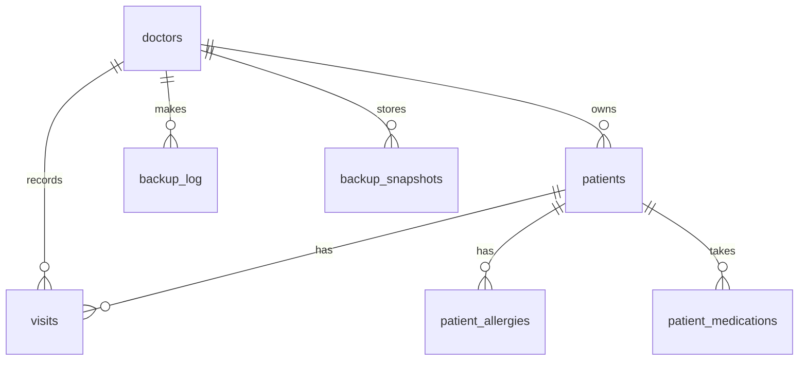

# MediTrack Pro: MySQL edition

Your MediTrack frontend, now backed by a real **MySQL 8** database through a small **Node.js / Express** API.
Nothing is stored in the browser any more except the login token.

```
meditrack-sql/
├── database/                 <- the SQL project
│   ├── 00_setup_all.sql        run everything in order
│   ├── 01_schema.sql           tables, constraints, generated columns, app user
│   ├── 02_views.sql            v_patient_overview, v_visit_history, ...
│   ├── 03_functions_procedures.sql
│   ├── 04_triggers.sql         validation, patient-ID generation, audit trail
│   ├── 05_sample_data.sql      2 doctors, 12 patients, 25 visits
│   └── 06_useful_queries.sql   15 reports / analytics queries
├── server/                   <- REST API (Express + mysql2)
│   ├── server.js, db.js, auth.js, validate.js, mapper.js, patientRepo.js
│   ├── routes/ (auth, patients, dashboard, backup)
│   └── test/smoke.js           54 end-to-end API checks
└── public/index.html         <- your frontend, now calling the API
```

## Quick start

Requirements: MySQL 8.0+, Node.js 18+.

```bash
# 1. Create the database (schema + views + procedures + triggers + sample data)
cd database
mysql -u root -p < 00_setup_all.sql

# 2. Configure and start the API
cd ../server
npm install
cp .env.example .env          # then edit: set JWT_SECRET (and DB_PASSWORD if you changed it)
npm start

# 3. Open http://localhost:3000
```

Demo logins: **demo / demo1234** (10 patients) and **drsmith / doctor123** (2 patients).
Each doctor only ever sees their own patients.

> The schema creates a MySQL user `meditrack_app` with the password `ChangeMe_123!`
> (only SELECT/INSERT/UPDATE/DELETE/EXECUTE on `meditrack`). Change it in `01_schema.sql`
> **and** `server/.env` before using this for anything real.

## Database design



**Every field in the frontend has a home:**

| Frontend field | Table.column |
|---|---|
| Username / Password | `doctors.username` / `doctors.password_hash` (bcrypt) |
| Patient ID (P100001) | `patients.patient_code` (generated by trigger) |
| Full Name, DOB, Gender, Phone, Email, Address | `patients.full_name`, `date_of_birth`, `gender`, `phone`, `email`, `address` |
| Medical History | `patients.medical_history` |
| Allergies (comma list) | `patient_allergies` (one row per allergen) |
| Current Medications (comma list) | `patient_medications` (one row per medication) |
| Heart Rate (BPM) | `visits.heart_rate` |
| Blood Sugar (mg/dL) | `visits.blood_sugar` |
| Temperature (°F) | `visits.temperature_f` |
| Weight (kg) / Height (cm) | `visits.weight_kg` / `visits.height_cm` |
| Blood Pressure "120/80" | `visits.bp_systolic` + `visits.bp_diastolic` |
| Chief Complaints, Current Condition, Doctor's Notes | `visits.chief_complaints`, `current_condition`, `doctors_notes` |
| Last Visit | `visits.visit_date` (latest visit) |
| Age | computed from `date_of_birth` |
| BMI + category | **generated columns** `visits.bmi`, `visits.bmi_category` |
| Status (critical / monitoring / stable) | **generated column** `visits.status`, same thresholds as the old JavaScript |
| Backup: last backup time | `backup_log` |
| Auto Backup snapshot | `backup_snapshots` (JSON) |

### Visit history
Vitals live in `visits`, one row per visit, so a patient's trend over time is kept instead of being overwritten.
When you edit a patient the form has a **"Record as a new visit"** checkbox (ticked by default). Untick it to
correct a typo in the latest visit without creating a new one. The patient modal shows the full visit history.

### What the database does for you
- **Generated columns**: `bmi`, `bmi_category`, `status` can never be out of sync with the vitals.
- **CHECK constraints**: impossible vitals (heart rate 900, systolic below diastolic) are rejected by MySQL itself.
- **Triggers**: generate patient codes, block future birth/visit dates, trim text, write `audit_log` rows.
- **Stored procedures**: `sp_add_visit`, `sp_search_patients`, `sp_dashboard_stats`, `sp_create_backup_snapshot`.
- **Functions**: `fn_calculate_age`, `fn_bmi`.
- **Views**: `v_patient_overview` (one row per patient with latest vitals), `v_visit_history`,
  `v_critical_patients`, `v_doctor_summary`, `v_latest_visit`.

To change the status thresholds, `ALTER TABLE visits MODIFY COLUMN status ...` with a new `CASE` expression.

## API

All routes except register/login need `Authorization: Bearer <token>`.

| Method | Route | Purpose |
|---|---|---|
| POST | `/api/auth/register` · `/api/auth/login` | create account / get token |
| GET | `/api/auth/me` | current doctor |
| GET | `/api/dashboard` | the 4 stat cards + 5 recent patients |
| GET | `/api/patients?search=&status=` | grid with search and status filter |
| GET | `/api/patients/:code` | one patient + visit history |
| POST | `/api/patients` | add patient (creates first visit) |
| PUT | `/api/patients/:code` | update; `newVisit: true/false` |
| DELETE | `/api/patients/:code` | delete patient and all their visits |
| GET | `/api/backup/info` · `/api/backup/export` | backup panel / JSON download |
| POST | `/api/backup/import` | `{patients, mode: "merge"\|"replace"}` |
| POST | `/api/backup/auto` | store a snapshot inside MySQL |

**Old backups still work.** A JSON file exported from the previous localStorage version can be imported;
each patient's vitals become their first visit, dated from their old `lastVisit`.

## Testing

```bash
cd server
LOGIN_MAX_FAILS=1000 npm start &     # the test deliberately fails a couple of logins
node test/smoke.js                   # 54 checks: auth, validation, isolation, CRUD, backup/restore
```

## Security notes
- Passwords are bcrypt-hashed; SQL uses parameterised queries only; all user text is HTML-escaped in the UI.
- Doctors are isolated at the query level: asking for another doctor's patient returns 404.
- Failed logins are rate-limited per IP (in memory).
- Before real use: run behind **HTTPS**, set a strong `JWT_SECRET`, change the DB password, and review
  privacy/compliance requirements (HIPAA, GDPR, etc.) for real patient data. This project is a solid base,
  not a certified medical system.
